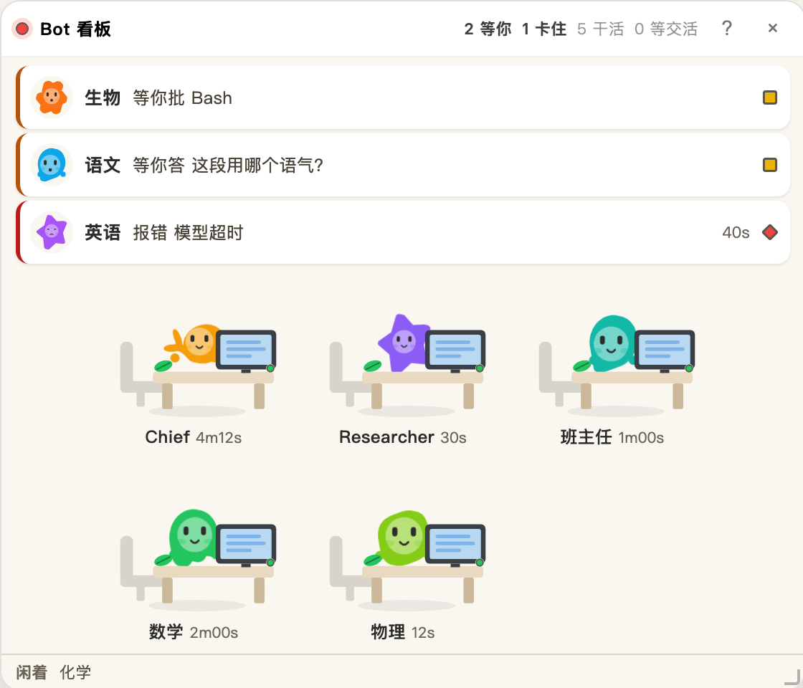

# dsh-bot-board

[](https://www.npmjs.com/package/dsh-bot-board)
[](LICENSE)
[](https://nodejs.org)

A floating board for [DS Bot](https://github.com/Fei2411/DeepSeek-Bot): what every Bot is doing right now, how long it has been running, what it is stuck on, and who is waiting on whom. No need to open each Bot's chat.



It is a [DeepSeek Harness](https://github.com/deepseek-ai/deepseek-harness) plugin and needs DS Bot installed — without DS Bot there is nothing to show, and the panel stays hidden. It reads DS Bot's own data and writes nothing of DS Bot's: no `state.json` edits, no `api/bot` calls that change state, not even a `locale` field that would flip your UI language. The panel's own position, size and collapsed state live in your browser's localStorage.

Requirements: DSH (a Developer Preview build is fine), DS Bot `0.1.7` or `0.2.0` (the two this was built against), Node ≥ 20 to build from source.

## Install

The package is on npm. Add it to your profile's `package.json` (`~/.dsh/profiles/desktop/package.json`) and register the bundle:

```json
{
  "dependencies": {
    "dsh-bot-board": "^0.7.1"
  },
  "dsh": {
    "profile": {
      "bundles": ["...", "dsh-bot-board"]
    }
  }
}
```

Then install in that directory with whatever the profile already uses — `pnpm install` if it has a `pnpm-lock.yaml`, otherwise `npm install` — and restart DSH completely:

```sh
killall -9 "DeepSeek Harness"    # osascript quit pops an automation prompt
```

To change the code instead of just using it, clone and link:

```sh
git clone https://github.com/coii08o0o/dsh-bot-board.git
cd dsh-bot-board
npm install
npm run build        # only needed after you edit src/
ln -sfn /path/to/dsh-bot-board ~/.dsh/profiles/desktop/node_modules/dsh-bot-board
killall -9 "DeepSeek Harness"
```

The panel appears bottom-right. The client half hot-reloads after `npm run build`; changes under `src/host/` need a restart.

Windows: the npm install needs no symlink at all. Only the source path does, and `ln -sfn` is Unix-only — use `mklink /D "%USERPROFILE%\.dsh\profiles\desktop\node_modules\dsh-bot-board" "C:\path\to\dsh-bot-board"` from an elevated `cmd`.

## What it shows

Three bands, ordered by whether you have to do anything:

1. Needs you — up to three rows of Bots waiting on an approval, a question, or a failed turn. Each row: the Bot's face, its name, the action in its own words, how long it has waited, and a lamp. When more than three are waiting the third row grows a `+N` chip that expands the list in place.
2. Moving — the classroom floor: Bots that are running, waiting on another Bot, or just finished (7 seconds). Hand-off edges sit above the grid.
3. Idle — one line of names. When nothing is running and nothing is owed, the line becomes a roster instead: one 44px row per resting Bot with its face, its name, its role (or model) and 闲着 on the right. The roster reflows to two or three columns on a smaller panel, so no Bot is ever behind a scroll. A `!` badge sits on a Bot that failed and has since gone quiet.

The three bands differ by image, row height, weight and surface, not by background colour. Status colour appears only on the 3px bar and the lamps.

### Six states

| State | Lamp | Shape | Means |
|---|---|---|---|
| Working | green | circle | running, thinking, searching, sending, handing over |
| Needs you | yellow | **square** | an approval, a question, or a new Bot waiting for a model pick |
| Waiting on a Bot | blue | circle | it is waiting for another Bot to hand work back, not for you |
| Stuck | red | **diamond** | failed, and not working now. After 3 quiet minutes it drops to idle with a red `!` |
| Idle | grey | circle | nothing running |
| Just finished | teal | circle | a clean hand-off landed; falls back after 7 seconds |

Colour alone does not carry the state: stuck is a diamond, needs-you is a square, the rest are circles, and each lamp has an outline. Green and red sit 13.6 ΔE apart for red-green colour blindness — close enough that shape has to do the work.

### Where the faces come from

A Bot's look is DS Bot's, not this board's. Two fields decide it:

| Axis | Source | Values |
|---|---|---|
| Character (body outline) | `bots[].avatar.shape` | `whale` `star` `moon` `wave` `squircle` `zed` `hex` |
| Colour | `bots[].color` | 19 named inks or any `#rrggbb` |
| Desk prop | this board | 10 props, hashed from the Bot id |

The seven outlines are redrawn from DS Bot's own shapes: the whale keeps its tail, the bull its horns, the blossom its petals. Face disc and eyes shrink per outline, because a star's concave points cannot hold an 18px disc; the two silhouettes without a round edge have no hands.

DS Bot stores those two fields only when the user picked them, so a new Bot usually has neither. Whatever is missing is hashed from the Bot id: 12 colours × 7 outlines × 10 props = 840 combinations, stable across refreshes, and a collision is re-rolled. Upstream always wins over the hash.

Names are not part of identity. A Bot called `Chief` gets nothing extra for the name — `avatar.shape` is a closed set of seven, and names are free text in whatever language you type.

## Where the data comes from

| What | From |
|---|---|
| Live status, current tool, elapsed time, approvals, questions, a new Bot waiting for a model | DS Bot's `POST api/bot` (`endpoint: "state"`), 1.5s while anything runs, 6s after 90s of a fully idle team |
| Hand-offs (`from`/`to`/`open`/`results`), room names | `~/.dsh/bot/state.json`, read by the host half, cached on `mtime+size`, polled every 5s |
| Failures | DSH's `agent/error`, mapped back to a Bot by session, kept for 15 minutes |

Polling slows down when the panel is collapsed, the window is hidden, or requests keep failing (exponential backoff, 8× cap, 30s ceiling). This is not about battery: `api/bot` runs `refresh + bootstrap + catalog + loadSecrets` on every call, and `unchanged` only saves response size. An idle board left open still costs the upstream 40 of those a minute, and that is what the slow-down reduces.

If you moved DS Bot's data folder (`bot.home` in its config), point this plugin at the same folder:

```yaml
- id: bot-board
  name: dsh-bot-board
  config:
    home: /path/to/bot-data   # default $DSH_HOME/bot
```

`state.json` carries DS Bot's data format version. If it is not `1`, the panel says so — a moved field fails by reading the wrong value, not by crashing, and silence would be worse.

## Known limits

- The panel lives in every DSH session, not only DS Bot's. It hides itself when there is no state file to read.
- Hand-offs only show what `state.json` still holds. DS Bot deletes a sub-record when the sub-task finishes, so chains break; there is no graph view, only the "in flight" table.
- No group-chat panel: `rooms[].log[]` has no timestamps, and group chat went unused on the machine this was built on.
- Failures cover what DSH's `agent/error` reports (model and tool steps); a dropped network connection is not one of them.
- The classroom is a light island by design. In a dark theme the room stays cream and the text stays dark.
- DS Bot's `avatar.image` (an uploaded photo, up to 160KB as a data URL) is not drawn. Seven outlines is the whole vocabulary here; a photo inside a 138px workstation is a different problem.
- DS Bot changing `api/bot` fields will need a matching change here. The ink values come from its `src/client/inks.js`.
- The snapshot is visible to any authenticated DSH session. `/api` checks an HttpOnly cookie and an owner principal and binds to loopback by default, but same-origin plugin scripts, remote `trustedHosts` and API operator tokens can read it.
- `state.json` is treated as semi-trusted input. A drifted or mistyped field degrades to an empty value instead of crashing the panel, which means a wrong value is possible; the panel says so when `dataVersion` does not match.
- Error text is copied into system notifications, which can appear on a lock screen or a shared screen. Turn notifications off for this plugin in sensitive environments.

## Development

```
src/host/index.js       host half: snapshot route, failure store
src/client/index.js     apply / slot registration
src/client/rows.js      row building (pure)
src/client/scene.js     state priority (pure)
src/client/layers.js    band membership, hand-off edges, idle demotion (pure)
src/client/station.js   workstation SVG, lamp component, blob
src/client/panel.js     shell, drag, resize, collapse, three bands
src/client/poll.js      the two pollers
src/client/cadence.js   polling rhythm (pure: slow down when the team is idle)
src/client/const.js     tunables, six states, seven characters, 19 inks
tools/build.mjs         esbuild bundle in __ModuleLoader__ format
tools/smoke.mjs         host snapshot + pure logic + artifact contract + CSS
tools/render-check.mjs  renders the component tree through a React shim
```

```sh
npm run build    # rebuild client.js after editing src/
npm run smoke
npm run render
npm run check    # all three, build first
npm run verify   # only: is client.js the build of the current src/?
npm run ci       # verify + smoke + render, no build
npm run preview  # static HTML of nine scenarios, measured in a browser
```

`verify` and `ci` exist because they do not build. `check` always builds first, so "the artifact is stale" cannot be expressed there — put an old `client.js` back and all 531 assertions still pass. `verify` compares the src fingerprint in the bundle banner against a fresh hash, and `ci` runs that plus both suites, so a forgotten build fails before release.

The `preview` export is not a mockup. It renders the real components with the real CSS and prints `clientHeight`/`scrollHeight` under each panel. That is how the 0.72px margin at 560×480 was measured.

`react` and `react-dom` stay external at build time and are injected by `__ModuleLoader__`; bundling a second React breaks hooks.

## Notes for the next plugin

- `connection.fetch.register` needs a leading slash (`/api/bot-board`); paths match exactly, not by prefix.
- The `connection` service may arrive after `apply()`. Wait with `ctx.inject(['connection'], cb)` — an early `if (!ctx.connection) return` registers nothing and says nothing.
- The id in `__ModuleLoader__.load({ id })` must equal the package name; rename the package without rebuilding and the bundle silently never loads.
- The panel sits in the `shell.overlay` slot above order 500, clear of DS Bot's 50/55/60.
- `rooms[].log[]` has no time field (only `seq`), so "3 minutes ago" has to be tracked yourself.
- `works[].room` is a room id, not a Bot id.
- `bots[].sessionId` is the current part; `segments[]` holds only ended parts. Collect both when mapping a session to a Bot, or errors from a Bot that rolled over a part go missing.
- `api/bot`'s `state` is not a pure read. Do not poll it at high frequency.
- After changing a host-half plugin, quit DSH entirely. `killall -9 "DeepSeek Harness"` is cleaner than `osascript quit`.

## Uninstall

Remove `dsh-bot-board` from the profile's `bundles` and `dependencies`, drop the link, restart.

## Issues

Include three things: your DSH version, your `ds-bot` version, and what the panel header says (or a screenshot). A DS Bot upgrade changing a field is the most common failure here, and the version number saves a round trip. Run `npm run ci` before opening a PR — it checks that `client.js` matches `src/`.

## License

MIT. See [LICENSE](LICENSE).

The seven character outlines come from [DS Bot](https://github.com/Fei2411/DeepSeek-Bot) (Apache-2.0), and the 19 ink values from its `inks.js`. The board redraws them as dumplings — face, eyes, hands and desk props are this project's. DS Bot is Apache-2.0 and the attribution stays here.

---

[中文说明](README.zh-CN.md)
